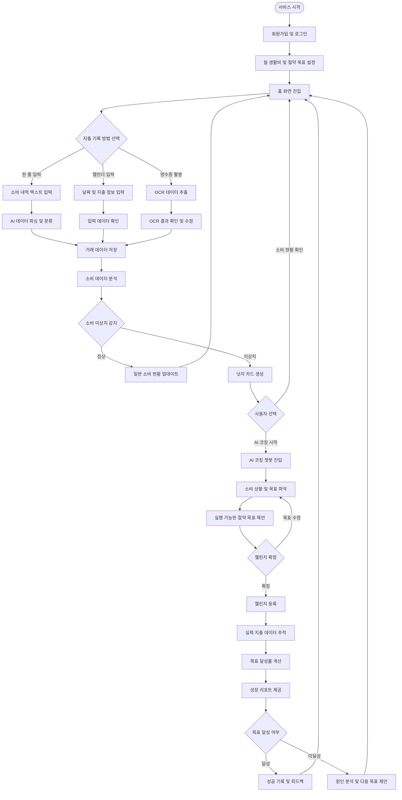
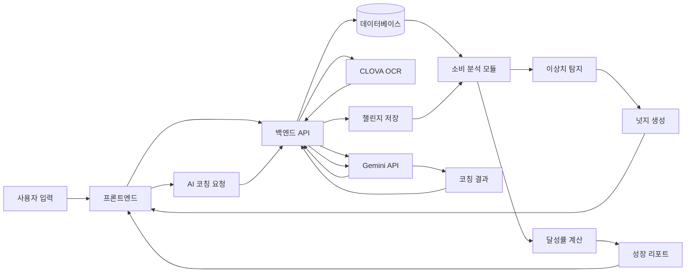

# 넛지형 AI 재무 코칭 가계부

> 아이디어를 현실로, 작은 불편함을 새로운 가치로.
>
> **기록하는 가계부에서, 행동을 바꾸는 가계부로.**

소비 지출을 기록하고 싶지만 작심삼일에 그치는 자취 1~2년 차 사회초년생을 위해, 소비의 맥락을 분석하고 실질적인 행동 변화를 유도하는 넛지형 AI 재무 코칭 가계부입니다.

**그려톤 3조** · 목표: 11월 20일 배포 완료 → 11월 21일 그려톤 해커톤에서 실제 작동하는 서비스 시연

- 프로토타입: https://heroic-croissant-e3afe9.netlify.app

---

## 1. 문제 정의

- 가계부를 쓰고 싶지만 수기 입력이 귀찮아 지속하지 못한다.
- 월말에 카드값을 확인하고 나서야 과소비를 인지한다.
- 배달비, 택시비 등 감정적 소비를 실시간으로 통제하기 어렵다.
- 단순한 소비 기록을 넘어 실제 행동 변화로 이어지기 어렵다.

**핵심 사용자:** 생활비를 절약하고 싶지만 수기 입력의 번거로움과 충동 소비 때문에 가계부를 꾸준히 관리하지 못하는 자취 1~2년 차 사회초년생

## 2. 핵심 서비스 흐름

```
지출 입력 → 소비 분석 → 이상치 감지 → 넛지 제공 → AI 코칭 → 챌린지 실행 → 성장 리포트
```

| 순서 | 사용자 행동 | 서비스 반응 |
| --- | --- | --- |
| 1 | 생활비 및 절약 목표 설정 | 개인별 기준 설정 |
| 2 | 수입·지출 기록 | AI 자동 분류 및 저장 |
| 3 | 홈 화면 확인 | 소비 현황 및 이상치 표시 |
| 4 | 넛지 카드 선택 | AI 코칭 챗봇 진입 |
| 5 | AI와 소비 상황 대화 | 실행 가능한 목표 제안 |
| 6 | 챌린지 확정 | 목표 및 기간 등록 |
| 7 | 평소처럼 소비 기록 | 실제 지출 데이터 추적 |
| 8 | 성장 리포트 확인 | 목표 달성 여부 및 피드백 제공 |



## 3. 핵심 기능

### 기능 1. 수입·지출 간편 입력

수기 입력의 번거로움을 줄여 꾸준한 기록을 유도합니다.

- **한 줄 텍스트 입력**: Gemini API가 날짜·금액·카테고리·메모를 파싱하고 자동 분류
- **캘린더 직접 입력**: 날짜와 지출 정보를 직접 입력하고 검증
- **영수증 촬영**: Naver CLOVA OCR로 정보를 추출하고, 사용자가 결과를 확인·수정

저장 항목: 거래 일자, 금액, 카테고리, 거래 메모, 수입/지출 구분

### 기능 2. 소비 이상치 탐지 및 넛지

월말 정산 전에 소비 패턴을 조기에 인식하도록 돕습니다.

- 카테고리별 주간·월간 소비 통계, 개인별 평균 지출, 과거 소비 패턴 분석
- 이동평균 및 Z-score 기반 이상치 탐지
- 이상 소비 시 홈 화면에 **넛지 카드** 표시 (이상 소비 카테고리, 평소 대비 증가율, 간단한 원인 설명, AI 코칭 시작 버튼)

넛지 메시지 예시:

- "이번 주 배달비가 평소보다 40% 높아요."
- "이번 달 택시비가 생활비의 15%를 차지하고 있어요."
- "이번 주 외식비를 조금 줄이면 목표 생활비에 가까워질 수 있어요."

### 기능 3. 대화형 목표 코칭 및 챌린지 성장 리포트

막연한 절약 의지를 구체적인 행동 목표로 바꾸고, 실제 소비 변화까지 확인합니다.

> **사용자**: 이번 달 배달비가 너무 많이 나왔어.
> **AI 코치**: 최근 배달비가 평소보다 많이 늘었네요. 배달을 줄이기 어려운 이유가 무엇인가요?
> **사용자**: 퇴근하고 요리하기 귀찮아서 자주 시켜 먹어.
> **AI 코치**: 그렇다면 이번 주에는 배달 횟수를 2회로 줄여보는 건 어떨까요?
> **사용자**: 좋아. 이번 주는 2회 이하로 해볼게.

- 챌린지 데이터: 이름, 목표 카테고리, 목표 금액/횟수, 시작일·종료일, 실제 소비, 달성 여부, 달성률
- 성장 리포트: 설정한 목표, 실제 소비 금액, 목표 대비 차이, 달성률, 성공/미달성 결과, 다음 챌린지 제안

## 4. 시스템 구조



| 단계 | 처리 주체 | 주요 처리 내용 |
| --- | --- | --- |
| 1 | 프론트엔드 | 거래 내역 입력 및 영수증 촬영 |
| 2 | Gemini API | 텍스트 파싱 및 자동 분류 |
| 3 | CLOVA OCR | 영수증 데이터 추출 |
| 4 | 백엔드 | 거래 데이터 검증 및 저장 |
| 5 | 분석 모듈 | 소비 통계 및 이상치 계산 |
| 6 | 백엔드 | 넛지 카드 생성 및 제공 |
| 7 | Gemini API | 대화형 목표 코칭 |
| 8 | 백엔드 | 챌린지 등록 및 달성률 계산 |
| 9 | 프론트엔드 | 성장 리포트 및 피드백 표시 |

### 제약사항

- 금융 API 및 거래 내역 자동 연동 제외 (수동 입력과 OCR로 데이터 확보)
- 사용자 입력이 없으면 소비 분석 불가
- Gemini API 한도 초과 시 Mock 템플릿으로 대체
- 전문 재무 자문 및 금융 상품 추천 제외

## 5. 성공 지표 (KPI)

AI 코칭 대화에서 사용자가 확정한 챌린지 중, 기간 내 목표를 달성한 비율이 **70% 이상**이면 성공으로 판단합니다.

```
챌린지 달성률 = 기간 내 목표 달성 챌린지 수 ÷ 기간이 종료된 전체 챌린지 수 × 100
```

측정 데이터: 챌린지 확정 수, 기간 종료 챌린지 수, 목표 달성 챌린지 수, 챌린지별 달성률

## 6. 팀

| 역할 | 이름 | 담당 업무 |
| --- | --- | --- |
| PM, AI | 조수인 | 프로젝트 총괄, 일정 관리, 협업 조율 및 AI 활용 지원 |
| FE | 김충 | UI/UX 구현, React 개발, API 연동 및 사용자 화면 구성 |
| BE | 박현호 | 서버 개발, API 설계, DB 구축 및 데이터 처리 |
| BE | 박준석 | 백엔드 기능 개발, 데이터 분석 로직 및 서버 연동 |
| AI | 서민지 | Gemini API 연동, AI 코칭 프롬프트 설계 및 OCR 연동 지원 |

**협업 원칙**

- 서로의 역할을 존중하고 진행 상황을 투명하게 공유합니다.
- 막히는 부분은 혼자 고민하기보다 빠르게 공유하고 함께 해결합니다.
- 기능 구현보다 사용자에게 실제로 필요한 기능인지 먼저 고민합니다.
- AI는 개발을 대신하는 도구가 아니라, 팀의 생산성과 문제 해결 능력을 높이는 조수로 활용합니다.
- 11월 20일 배포 완료를 최우선 목표로 삼고, 핵심 기능부터 완성합니다.

## 7. 일정

| 날짜 | 일정 | 목표 |
| --- | --- | --- |
| 10/29 ~ 11/5 | 기획 및 설계 | 요구사항 확정, 화면 설계, DB 및 API 설계 |
| 11/5 ~ 11/13 | 핵심 기능 개발 | 수입·지출 입력, DB 구축, AI 파싱 |
| 11/13 ~ 11/15 | 기능 통합 | 이상치 탐지, AI 코칭, 챌린지 기능 연결 |
| 11/16 ~ 11/17 | 테스트 및 개선 | 오류 수정, UI 개선, 기능 검증 |
| 11/18 ~ 11/19 | 최종 점검 | 통합 테스트, 발표 자료 및 시연 준비 |
| **11/20** | **최종 배포 완료** | 서비스 배포 및 시연 환경 확인 |
| **11/21** | **그려톤 해커톤 당일** | 최종 발표 및 서비스 시연 |

## 8. 개발 로드맵

**Phase 1. 기획 및 설계**
- [x] 서비스 요구사항 명세서(SRS) 작성
- [x] 사용자 시나리오 및 워크플로우 작성
- [x] UI/UX 및 프로토타입 설계
- [x] DB 구조 설계 (회원 인증·인가는 JWT 기준으로 ERD 작성)
- [x] API 명세서 작성
- [x] GitHub 저장소 및 협업 환경 구성

**Phase 2. 핵심 기능 개발**
- [ ] 회원가입 및 로그인
- [ ] 수입·지출 간편 입력
- [ ] AI 소비 데이터 파싱
- [ ] 영수증 OCR 연동
- [ ] 거래 데이터 저장 및 조회
- [ ] 소비 통계 및 이상치 탐지

**Phase 3. AI 코칭 및 챌린지**
- [ ] 넛지 카드 생성 및 표시
- [ ] Gemini API 기반 AI 코칭 챗봇
- [ ] 절약 목표 제안 및 챌린지 등록
- [ ] 실제 지출 데이터 기반 달성률 계산
- [ ] 챌린지 성장 리포트 구현

**Phase 4. 테스트 및 배포**
- [ ] 프론트엔드·백엔드 통합 테스트
- [ ] AI API 오류 및 한도 초과 대응
- [ ] UI/UX 개선 및 반응형 확인
- [ ] 최종 배포
- [ ] 발표 시연 시나리오 작성
- [ ] 해커톤 발표 준비

## 9. 문서

프로젝트 기획서 · PRD · 워크플로우 · UI/UX 설계 · API 명세서 · DB 설계서 · 회의록 · 테스트 케이스 · 발표 자료

## 10. 협업 규칙

**회의**

1. 회의 전 각자 진행 상황과 문제점을 공유합니다.
2. 회의 후 결정 사항과 담당자를 기록합니다.
3. 기능 구현 중 문제가 발생하면 즉시 팀에 공유합니다.
4. 코드 변경 전 GitHub 이슈 및 작업 내용을 확인합니다.
5. 배포 전 모든 팀원이 주요 기능을 확인합니다.

**Git 브랜치**

- `main`: 배포 가능한 안정 버전
- `develop`: 개발 통합 브랜치
- `feature/*`: 기능별 개발 브랜치
- `fix/*`: 오류 수정 브랜치

**커밋 메시지 예시**

- `feat: 지출 입력 기능 구현`
- `fix: AI 데이터 파싱 오류 수정`
- `docs: API 명세서 작성`
- `refactor: 소비 분석 로직 개선`

## 11. Vision

> 우리가 만드는 것은 단순히 돈을 기록하는 가계부가 아닙니다.
> 사용자가 자신의 소비를 이해하고, 더 나은 선택을 할 수 있도록 돕는 서비스입니다.
> 작은 기록 하나가 행동의 변화로 이어지고, 그 변화가 더 나은 생활 습관으로 이어질 수 있도록.
>
> **그려톤 3조, 함께 그려 나가는 더 나은 금융 생활.**
